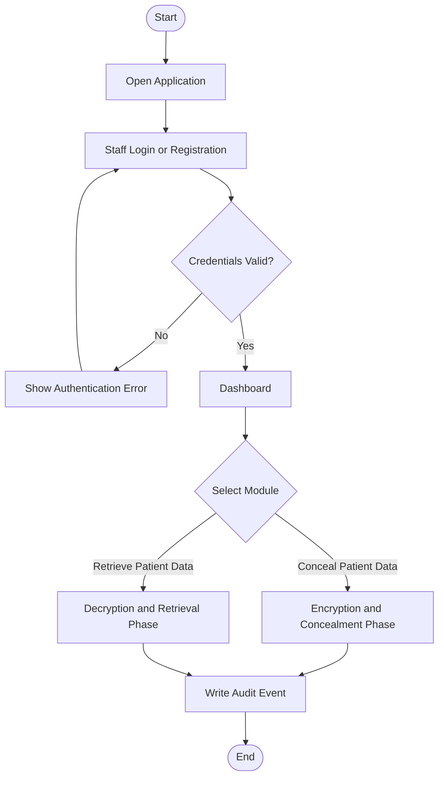
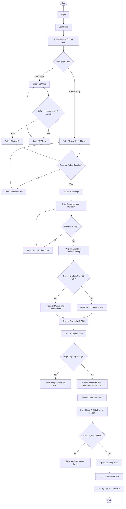
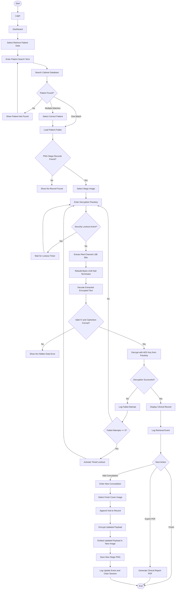
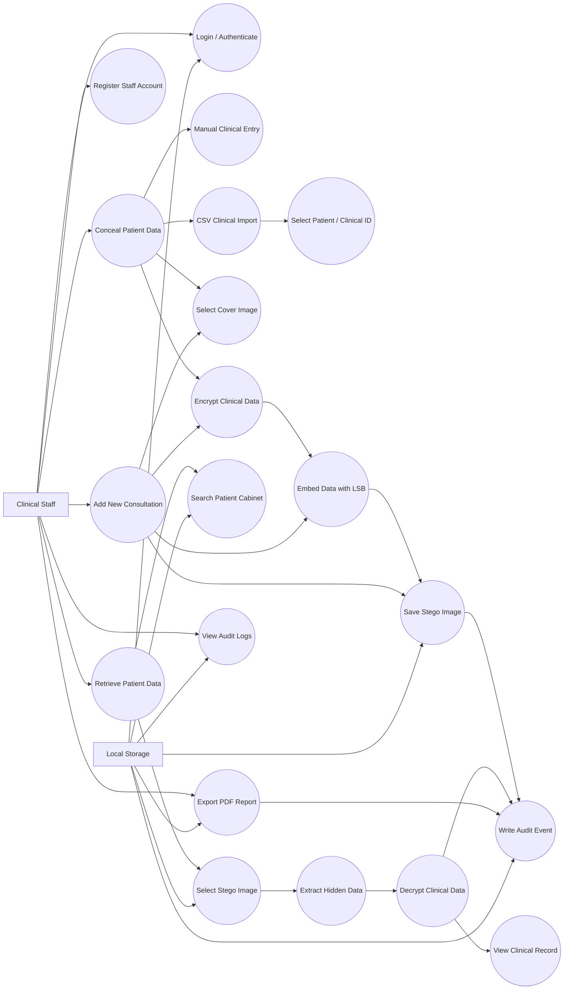
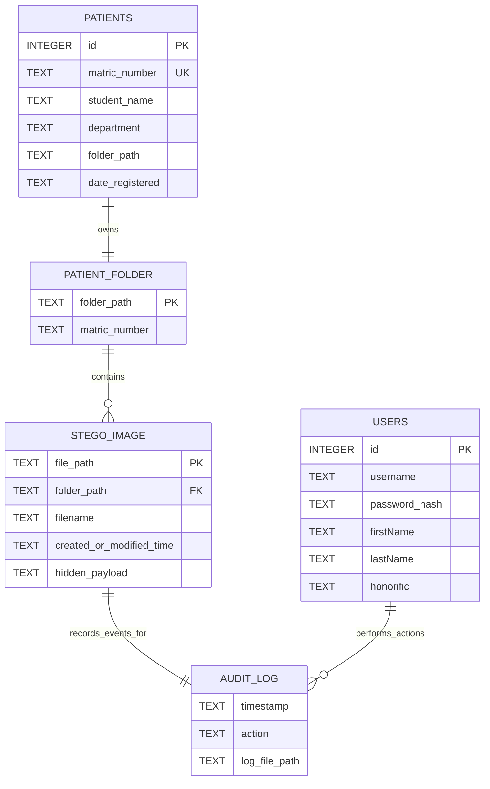

# Clinical Stego

Clinical Stego is a Flutter application for securing clinical/student medical records by encrypting the record data and hiding the encrypted payload inside a PNG image using Least Significant Bit (LSB) steganography. The system supports authenticated clinical staff, manual clinical record entry, CSV record import, patient cabinet registration, stego-image retrieval, decryption, consultation updates, PDF export, and audit logging.

## Main System Components

- `LoginPage`: registers and authenticates clinical staff.
- `Dashboard`: gives authorized users access to concealment and retrieval modules.
- `ConcealPage`: collects clinical data, encrypts it, embeds it in a cover image, and saves the stego-image.
- `RetrievePage`: searches the patient cabinet, extracts hidden encrypted data, decrypts it, displays the record, supports new consultation updates, and exports PDF reports.
- `SecretCipher`: derives an AES key from the passkey and performs encryption/decryption.
- `LsbEngine`: embeds and extracts encrypted text through the red-channel LSB of image pixels.
- `CabinetService`: manages the local SQLite patient cabinet and creates patient folders.
- `AuthService`: manages staff account registration and login.
- `AuditLogger`: writes security/audit events to the local audit log file.

## Overall System Workflow

1. Clinical staff opens the application.
2. Staff creates an account or logs in with existing credentials.
3. System validates the username and hashed password in the local authentication database.
4. Authenticated staff enters the dashboard.
5. Staff selects either:
   - `Conceal Patient Data` for encryption and steganographic hiding.
   - `Retrieve Patient Data` for extraction, decryption, viewing, updating, and reporting.
6. Every important security action is recorded in the local audit log.



## Encryption Phase Workflow

This phase creates a secure stego-image from clinical record data.

1. Staff logs in and opens the dashboard.
2. Staff selects `Conceal Patient Data`.
3. Staff chooses data entry mode:
   - Manual entry: enters matric number/clinical ID, name, department, age, gender, blood group, phone, complaint, diagnosis, and prescription.
   - CSV import: imports a CSV file whose first header is `Clinical_ID`, then selects one patient/clinical ID.
4. System validates required clinical fields or validates the CSV header and selected clinical ID.
5. Staff selects a cover image.
6. Staff enters a strong passkey.
7. System checks passkey strength:
   - Minimum 8 characters.
   - Uppercase and lowercase letters.
   - At least one number.
   - At least one supported special character.
8. System formats the clinical record as a structured payload string.
9. System checks the local cabinet database for the patient/matric number.
10. If the patient already exists, the existing patient folder is used.
11. If the patient does not exist, the system registers the patient in the cabinet database and creates a patient folder.
12. System derives a 32-byte AES key from the passkey using SHA-256 over the passkey and static salt.
13. System encrypts the clinical payload using AES.
14. System combines the IV and encrypted content as `iv_base64:ciphertext_base64`.
15. System decodes the selected cover image.
16. System converts the encrypted payload plus a null terminator into binary bits.
17. System validates that the image has enough pixels to hold the payload.
18. System embeds each payload bit into the least significant bit of the red channel of consecutive pixels.
19. System calculates MSE and PSNR between the original image and stego-image.
20. System saves the stego-image as a PNG inside the patient's cabinet folder.
21. System extracts the saved payload again to verify that the saved PNG still contains the correct encrypted data.
22. Optionally, the system saves a copy to the gallery.
23. System logs the concealment event.
24. System displays the stego-image and security metrics.



## Decryption Phase Workflow

This phase retrieves the hidden clinical record from a stego-image.

1. Staff logs in and opens the dashboard.
2. Staff selects `Retrieve Patient Data`.
3. Staff enters a matric number, clinical ID, or patient search term.
4. System searches the local cabinet database.
5. If no patient is found, the system displays a not-found message.
6. If one patient is found, the system loads that patient's cabinet folder.
7. If multiple patients are found, staff selects the correct patient.
8. System lists PNG stego-images in the selected patient folder, newest first.
9. Staff selects the stego-image to retrieve.
10. Staff enters the decryption passkey.
11. System checks if a brute-force lockout is active.
12. System extracts LSB bits from the red channel of the selected PNG.
13. System groups bits into bytes until the null terminator is reached.
14. System decodes the extracted bytes into the hidden encrypted text.
15. System validates that the extracted text contains the expected `iv:ciphertext` format.
16. System derives the AES key from the entered passkey.
17. System attempts to decrypt the hidden encrypted text.
18. If decryption fails, the failed attempt count increases and an audit event is logged.
19. After repeated failures, the system activates a timed lockout.
20. If decryption succeeds, the system displays the clinical profile and medical history.
21. System logs the successful retrieval event.
22. Staff may export the record as a PDF report.
23. Staff may add a new consultation:
   - Enter new complaint, diagnosis, and prescription.
   - Select a fresh cover image.
   - Append the new visit block to the decrypted record.
   - Re-encrypt the updated payload.
   - Embed it into the new cover image.
   - Save a new stego PNG in the same patient folder.
   - Log the update event.
   - Clear the session for security.



## Use Case Diagram

### Actors

- `Clinical Staff`: main authorized user of the system. This includes doctors, nurses, consultants, professors, or other approved clinical personnel.
- `Local Storage`: supporting system actor representing SQLite databases, patient folders, stego PNG files, gallery storage, PDF output, and the audit log.

### Use Cases

- Register staff account.
- Login/authenticate.
- Conceal patient data.
- Enter clinical data manually.
- Import clinical data from CSV.
- Select patient/clinical ID.
- Select cover image.
- Encrypt clinical data.
- Embed encrypted data into image.
- Save stego-image to patient cabinet.
- Retrieve patient data.
- Search patient cabinet.
- Select stego-image.
- Extract hidden data.
- Decrypt clinical data.
- View clinical record.
- Add new consultation.
- Export PDF report.
- View audit logs.
- Write audit event.



## Database and Storage Diagram

The current project uses two SQLite databases and file-based storage. The actual clinical medical details are not stored as normal database rows. They are formatted into a payload string, encrypted, and hidden inside PNG stego-images saved in patient folders.

### Physical Persistence

- `clinical_auth.db`
  - Stores staff login profiles in the `users` table.
- `custech_cabinet.db`
  - Stores patient cabinet metadata in the `patients` table.
  - Does not store diagnosis, prescription, or full medical secrets.
- Application documents folder
  - Contains the `CUSTECH_Clinical_Stego/<matric_number>/` folders.
  - Each folder contains one or more stego PNG records.
- `clinical_audit.log`
  - Stores audit events as timestamped text entries.



### Logical Hidden Clinical Record Structure

Inside each stego-image, the decrypted payload is structured as text sections separated with `:::`. The first section is the header row, the second section is the patient profile row, and later sections are visit/consultation records.

```text
Clinical_ID|Student_Name|Department|Age|Gender|Blood_Group|Phone|Date_Registered
:::
<matric>|<name>|<department>|<age>|<gender>|<blood_group>|<phone>|<date_time>
:::
VISIT|<date_time>|<complaint>|<diagnosis>|<prescription>
:::
VISIT|<date_time>|<complaint>|<diagnosis>|<prescription>
```

### Diagram Notes

- `USERS.password_hash` represents the SHA-256 hash stored by `AuthService`.
- `PATIENTS.folder_path` points to the patient's local folder.
- `STEGO_IMAGE.hidden_payload` is not a database column. It represents the encrypted clinical payload hidden inside each PNG file.
- `AUDIT_LOG` is a text log file, not a SQLite table in the current implementation.

## Important Algorithms

### Authentication

1. Staff password is hashed with SHA-256.
2. Login compares the entered username and hashed password with the `users` table.
3. Valid users are sent to the dashboard.

### AES Encryption

1. Passkey is combined with a static salt.
2. SHA-256 generates a 32-byte key suitable for AES-256.
3. Payload is encrypted with AES.
4. Encrypted data is stored as `iv_base64:ciphertext_base64`.

### LSB Embedding

1. Encrypted text is UTF-8 encoded.
2. A null terminator is added to mark the end of hidden data.
3. Bytes are converted to bits.
4. Each bit is written into the least significant bit of the red channel of one pixel.
5. The modified image is saved as PNG to preserve exact pixel values.

### LSB Extraction

1. The stego PNG is decoded.
2. The red-channel LSB of each pixel is read.
3. Bits are grouped into bytes.
4. Extraction stops at the null terminator.
5. Extracted encrypted text is decrypted with the correct passkey.

## Running the Project

```bash
flutter pub get
flutter run
```

## Testing

```bash
flutter test
```
